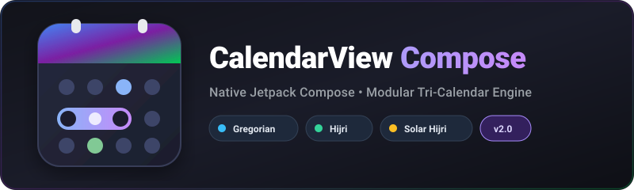

<p align="center">
  
</p>

<p align="center">
  <a href="https://jitpack.io/#mortezasun/android-calendarview"></a>
  <a href="https://github.com/mortezasun/android-calendarview/actions/workflows/android-verification.yml"></a>
  <a href="https://github.com/mortezasun/android-calendarview/actions/workflows/android-instrumentation.yml"></a>
  
  
  
</p>

A Kotlin Multiplatform Jetpack Compose calendar library for Android, the JVM and iOS. It ships one shared, calendar-independent core (month grid, selection engine, containers, heatmaps) plus pluggable calendar engines for **Gregorian**, **Islamic Hijri**, **Solar Hijri (Jalali / Persian)** and the **Chinese lunisolar calendar** — with full RTL support.

The Kotlin Multiplatform APIs described here are released as `3.0.0`. See [ADR 0006](docs/decisions/0006-kotlin-multiplatform-calendar-modules.md) for the breaking changes from the Android-only release.

**Current release:** [`3.0.0`](https://github.com/mortezasun/android-calendarview/releases/tag/3.0.0) is the Kotlin Multiplatform release for Android, the JVM and iOS. The previous Android release is [`2.4.0`](https://github.com/mortezasun/android-calendarview/releases/tag/2.4.0). See the [3.0.0 release notes](docs/releases/3.0.0.md) and [short changelog](docs/releases/3.0.0-changelog.md). JitPack built `3.0.0` with all seven modules and the BOM, and JVM plus minified Android consumers resolved the release only from JitPack on 2026-11-16; still verify the coordinates in your own build before pinning production dependencies.

Remaining real gates: iOS runtime/simulator tests need macOS/Xcode, Maven Central signing and
credentials are not configured, and real process-death plus physical-device/fold/TalkBack coverage
needs dedicated hardware. Dokka docs, benchmarks and the Gradle 9.9.1 gate are covered on this
branch; no new tag is associated with that tooling.

---

## Contents

- [Features](#-features)
- [Modules](#-modules)
- [Examples](#-examples)
- [Installation](#-installation)
- [Bill of Materials](#-bill-of-materials)
- [Quick start](#-quick-start)
- [Selection modes](#-selection-modes)
- [Month navigation](#-month-navigation)
- [Week and agenda](#-week-and-agenda)
- [Markers and week numbers](#-markers-and-week-numbers)
- [Adaptive months](#-adaptive-months)
- [Customization](#-customization)
- [Scrolling containers](#-scrolling-containers)
- [Heatmaps](#-heatmaps)
- [Custom calendars (low-level grid)](#-custom-calendars-low-level-grid)
- [Migrating from 1.x](#-migrating-from-1x)
- [Building from source](#-building-from-source)
- [Documentation](#-documentation)
- [License](#-license)

---

## ✨ Features

- **100% Jetpack Compose** – no XML layouts, ViewBinding or reflection.
- **Multiple calendar systems** – Gregorian (`GregorianYearMonth`), Hijri (`HijriDate`, Umm al-Qura by default), Solar Hijri (`SolarHijriDate`, own dependency-free engine) and Chinese lunisolar (own dependency-free Kotlin engine with leap months, Chinese years 1901–2099). Every engine shares epoch-day identities and platform formatters; Hijri month and week data accept a `HijriDateProvider` for local method adjustments.
- **One selection engine for all calendars** – `None`, `Single`, `Multiple` and `Range`, keyed by absolute epoch days and saved across process death via `rememberSaveable`.
- **Configurable month grid** – dynamic rows or fixed 6 rows (42 cells), independently toggleable previous/next-month days, header/weekday visibility, disabled dates and a customizable *today* border.
- **Scrolling containers** – `CalendarMonthList` (`LazyColumn`/`LazyRow`) and `CalendarMonthPager` (`HorizontalPager`/`VerticalPager`).
- **Month navigation** – `CalendarMonthHeader` plus saveable engine month states (`rememberGregorianMonthState`, `rememberHijriMonthState`, `rememberSolarHijriMonthState`, `rememberSolarHijriNativeMonthState`, `rememberChineseMonthState`) with inclusive bounds and a today action.
- **Shared month data** – every engine month snapshot implements `CalendarMonthData`; `toHeatmap()` turns any month into the calendar-agnostic year-heatmap format.
- **Week and agenda** – `CalendarWeekGrid` renders a seven-day week from engine `*WeekData`; `CalendarAgenda` renders a bounded vertical day list with the same selection and marker semantics.
- **Markers and week numbers** – caller-owned epoch-day markers render as accessible event dots; an optional caller-formatted week-number column is available on month and week grids.
- **Adaptive months** – `CalendarMonthColumns` derives one or more month columns from the available width for tablets, split screen and foldables.
- **Style and range limits** – `CalendarStyle` provides optional cell colors, while `CalendarRangePolicy` enforces inclusive minimum/maximum range lengths in the selection state.
- **Heatmaps** – Gregorian quarter/year heatmaps plus a calendar-agnostic year heatmap for any engine, with the same options as the month views (colors, today border, disabled dates, selection, RTL) and switchable orientation and cell style.
- **Accessibility & RTL** – localized content descriptions, heading and grid-collection semantics, an optional localized *today* description, and a layout that follows the ambient `LayoutDirection`. Day cells keep a 48 dp minimum height; the seven-column row shares the width, so very narrow windows (for example a 320 dp split screen) can fall below 48 dp per column.
- **Controlled & stateless** – the caller owns selection and navigation; the library only renders and reports clicks.

---

## 🧱 Modules

| Module | Package | Purpose |
|--------|---------|---------|
| `:library` | `com.develotter.calendarview` | Core: `CalendarMonthGrid`, selection engine, containers, heatmaps, shared month data and the month header. No calendar-engine dependencies. |
| `:calendar-gregorian` | `…calendars.gregorian` | `GregorianCalendarMonth`, backed by the KMP `GregorianYearMonth` value type and platform formatters. |
| `:calendar-hijri` | `…calendars.hijri` | `HijriCalendarMonth`, backed by the KMP `HijriDate` value type; the Umm al-Qura chronology comes from the platform. |
| `:calendar-solarHijri` | `…calendars.solarHijri` | `SolarHijriCalendarMonth`, a facade over the dependency-free `:calendar-solarHijri-native` engine; no `ir.huri:jalalicalendar` dependency. |
| `:calendar-solarHijri-native` | `…calendars.solarHijriNative` | `SolarHijriNativeCalendarMonth`, dependency-free Borkowski engine (`-61..3177` AP), immutable `SolarHijriDate` with epoch-day APIs; Android, JVM and iOS targets. |
| `:calendar-chinese-native` | `…calendars.chineseNative` | Self-written Kotlin Multiplatform lunisolar engine: immutable `ChineseMonth`/`ChineseDate`, leap months, `ChineseCalendarEngine`, formatting. JVM, `linuxX64`, Android and iOS targets; no Compose or third-party calendar dependency. |
| `:calendar-chinese-compose` | `…calendars.chineseCompose` | `ChineseCalendarMonth`, Gregorian grid with Chinese labels, week data, saveable `ChineseMonthState`, year/month heatmaps. Depends only on the Chinese engine, `:calendar-gregorian` and `:library`. |
| `:calendar-bom` | – | Version constraints for the seven published library artifacts. No runtime code. |
| `:calendarviewsample` | `com.develotter.calendarviewsample` | Android-only interactive demo app (all five calendars, month/week/agenda views, containers, adaptive columns, markers, week numbers, styles, range policy, month header and Hijri method offset, heatmaps). |

Every Compose calendar module depends on `:library` via `api`, so adding an engine is enough to get the core. The Chinese engine is usable on its own without `:library`, Compose or Android. `:calendar-bom` aligns the published versions but is not a runtime dependency.

---

## 🧪 Examples

The repository has two checked-in example paths:

- **Android demo:** [`calendarviewsample`](calendarviewsample/README.md) is the full, runnable Android demo. It covers all five calendars (Gregorian, Hijri, both Solar Hijri entries and Chinese), month/week/agenda views, heatmaps, adaptive panes, markers, week numbers, range policy, styles and saved state. It is an **Android application only**; this repository has no JVM or iOS demo app.
- **Minimal consumers:** [`tools/consumer-check`](tools/consumer-check) contains a JVM console consumer and a minimal Android Compose consumer. They resolve the BOM coordinates from an isolated Maven repository and exercise **only the Chinese engine path**; they are integration checks, not a complete gallery.

```bash
./gradlew :calendarviewsample:assembleDebug
adb install -r calendarviewsample/build/outputs/apk/debug/calendarviewsample-debug.apk
```

See [calendarviewsample/README.md](calendarviewsample/README.md) for the feature map and test commands.

---

## 📦 Installation

Add JitPack to `settings.gradle.kts`:

```kotlin
dependencyResolutionManagement {
    repositoriesMode.set(RepositoriesMode.FAIL_ON_PROJECT_REPOS)
    repositories {
        google()
        mavenCentral()
        maven { url = uri("https://jitpack.io") }
    }
}
```

Add the engines you need to your module's `build.gradle.kts`:

```kotlin
dependencies {
    // Core only (needed if you build your own calendar on top of CalendarMonthGrid)
    implementation("com.github.mortezasun.android-calendarview:library:3.0.0")

    // Calendar engines (each one already includes :library)
    implementation("com.github.mortezasun.android-calendarview:calendar-gregorian:3.0.0")
    implementation("com.github.mortezasun.android-calendarview:calendar-hijri:3.0.0")
    implementation("com.github.mortezasun.android-calendarview:calendar-solarHijri:3.0.0")
    // Or dependency-free native Solar Hijri engine (immutable SolarHijriDate, no jalalicalendar):
    implementation("com.github.mortezasun.android-calendarview:calendar-solarHijri-native:3.0.0")

    // Chinese lunisolar engine and optional Compose facade:
    implementation("com.github.mortezasun.android-calendarview:calendar-chinese-native:3.0.0")
    implementation("com.github.mortezasun.android-calendarview:calendar-chinese-compose:3.0.0")
}
```

The current release is `3.0.0`. JitPack built the tag with all seven modules; verify the
coordinates in your own build before pinning production dependencies.

### Bill of Materials (3.0.0)

The current BOM is `3.0.0` and constrains all seven published modules:

```kotlin
dependencies {
    implementation(platform("com.github.mortezasun.android-calendarview:calendar-bom:3.0.0"))
    implementation("com.github.mortezasun.android-calendarview:calendar-gregorian")
    implementation("com.github.mortezasun.android-calendarview:calendar-hijri")
    implementation("com.github.mortezasun.android-calendarview:calendar-solarHijri")
    implementation("com.github.mortezasun.android-calendarview:calendar-solarHijri-native")
    implementation("com.github.mortezasun.android-calendarview:calendar-chinese-native")
    implementation("com.github.mortezasun.android-calendarview:calendar-chinese-compose")
}
```

The BOM is part of the same publication set and is included by `jitpack.yml` and the
publishing workflow. JitPack built `3.0.0` with all seven modules and its BOM, and JVM plus
minified Android BOM consumers resolved the release only from JitPack on 2026-11-16. The POM
contains the metadata Maven Central requires, but signing, namespace verification and upload are
not configured; JitPack remains the only configured remote repository.

If you only need one engine, keep its explicit version and omit the BOM.

### Upgrading to the current release (3.0.0)

`3.0.0` is a breaking Kotlin Multiplatform release. Update direct versions or the BOM platform,
then migrate the public date/callback types as described below:

```kotlin
dependencies {
    implementation(platform("com.github.mortezasun.android-calendarview:calendar-bom:3.0.0"))
    implementation("com.github.mortezasun.android-calendarview:calendar-gregorian")
    implementation("com.github.mortezasun.android-calendarview:calendar-hijri")
}
```

The Hijri engine's provider parameter is optional; omit it to keep Umm al-Qura. To use a local
offset, pass the same provider to the month state, the month view and the click mapping:

```kotlin
val todayEpochDay = 20_393L // from your platform clock
val selectionState = rememberCalendarSelectionState(TypeSelectDay.Single)
val hijriMethod = OffsetHijriDateProvider(offsetDays = 1)
val hijriToday = hijriMethod.dateForEpochDay(todayEpochDay)
val monthState = rememberHijriMonthState(
    initialMonth = hijriToday,
    dateProvider = hijriMethod,
)

HijriCalendarMonth(
    month = monthState.month,
    selection = selectionState.selection,
    onDateClick = { epochDay -> selectionState.onDayClick(epochDay) },
    todayEpochDay = todayEpochDay,
    dateProvider = hijriMethod,
)
```

### Migrating from 2.4.0

`3.0.0` replaces JVM date and locale types in public signatures:

- Every callback and predicate takes an epoch day (`Long`); `firstDayOfWeek` is an ISO number
  (1..7) and `todayEpochDay` replaces `today`.
- `YearMonth` becomes `GregorianYearMonth`, `HijrahDate` becomes `HijriDate` and
  `JalaliCalendar` becomes `SolarHijriDate`. `Locale` parameters are gone; labels come from the
  platform formatter.
- `ir.huri:jalalicalendar` is no longer used: `:calendar-solarHijri` is a facade over
  `:calendar-solarHijri-native`.
- The `@Deprecated(HIDDEN)` `java.time` overloads were removed. Android/JVM hosts can convert at
  the boundary with `SolarHijriDate.toLocalDate()` and the `HijriDateProvider` mappings.

Shared code compiles for Android, the JVM and the iOS targets; the iOS klibs are published and
ABI-checked, but iOS runtime verification is still pending (see
[ADR 0006](docs/decisions/0006-kotlin-multiplatform-calendar-modules.md)). Published coordinates
stay `...:library` and Gradle resolves the Android AAR (`library-android`) through Gradle Module
Metadata.

---

## 🚀 Quick start

### Gregorian

```kotlin
@Composable
fun GregorianScreen() {
    val state = rememberCalendarSelectionState(TypeSelectDay.Range)

    GregorianCalendarMonth(
        month = GregorianYearMonth.now(),
        selection = state.selection,
        onDateClick = { epochDay -> state.onDayClick(epochDay) },
        showPreviousMonthDays = true,
        showNextMonthDays = true,
        fixedSixRows = true,
    )
}
```

### Hijri (Islamic)

```kotlin
@Composable
fun HijriScreen() {
    val todayEpochDay = 20_393L // from your platform clock
    val state = rememberCalendarSelectionState(TypeSelectDay.Single)

    HijriCalendarMonth(
        month = UmmAlQuraHijriDateProvider.dateForEpochDay(todayEpochDay),
        selection = state.selection,
        onDateClick = { epochDay -> state.onDayClick(epochDay) },
    )
}
```

Umm al-Qura is the default method. To model a local adjustment, use a provider and pass
the same provider's today value:

```kotlin
// existing state from the surrounding screen
val todayEpochDay = 20_393L // from your platform clock
val selectionState = rememberCalendarSelectionState(TypeSelectDay.Single)
val hijriMethod = OffsetHijriDateProvider(offsetDays = 1)
val hijriToday = hijriMethod.dateForEpochDay(todayEpochDay)

HijriCalendarMonth(
    month = hijriToday,
    selection = selectionState.selection,
    onDateClick = { epochDay -> selectionState.onDayClick(epochDay) },
    todayEpochDay = todayEpochDay,
    dateProvider = hijriMethod,
)
```

A provider maps epoch days to `HijriDate` and back. `hijriMonthData` and `hijriWeekData`
accept the same `dateProvider`; the provider affects labels and the displayed today, while
selection and every callback remain keyed by absolute epoch day.

### Solar Hijri / Jalali (Persian)

Both Solar Hijri modules use the dependency-free engine and the immutable `SolarHijriDate`. `:calendar-solarHijri-native` exposes `SolarHijriNativeCalendarMonth`:

```kotlin
import com.develotter.calendarview.calendars.solarHijriNative.SolarHijriDate
import com.develotter.calendarview.calendars.solarHijriNative.compose.SolarHijriNativeCalendarMonth
import com.develotter.calendarview.compose.rememberCalendarSelectionState

@Composable
fun SolarHijriNativeScreen() {
    val state = rememberCalendarSelectionState()
    SolarHijriNativeCalendarMonth(
        month = SolarHijriDate.now(),
        selection = state.selection,
        onDateClick = { epochDay -> state.onDayClick(epochDay) },
    )
}
```

### Chinese (native lunisolar)

`:calendar-chinese-native` computes offline from a versioned month table generated by
`tools/chinese-calendar/generate.py` (VSOP87D + Meeus solar/lunar algorithms). No HKO table or
other calendar engine is embedded. Supported Chinese years are `1901..2099`
(Gregorian `1901-02-19..2100-02-08`); leap months are explicit and never encoded as month 13.

```kotlin
import com.develotter.calendarview.calendars.chineseNative.ChineseCalendarEngine
import com.develotter.calendarview.calendars.chineseNative.ChineseDate
import com.develotter.calendarview.calendars.chineseNative.ChineseMonth

// Pure Kotlin/JVM: no Compose, Android or other calendar module needed.
val newYear = ChineseDate.of(2024, monthNumber = 1, isLeapMonth = false, dayOfMonth = 1)
val epochDay = newYear.toEpochDay()
val sameDay = ChineseDate.fromEpochDay(epochDay)

val leapSecondMonth = ChineseCalendarEngine.leapMonth(2023) // ChineseMonth(2023, 2, leap = true)
val months = ChineseCalendarEngine.monthsInYear(2023)       // 13 entries, leap month after month 2
```

Compose facade:

```kotlin
import com.develotter.calendarview.calendars.chineseNative.ChineseMonth
import com.develotter.calendarview.calendars.chineseNative.ChineseTextStyle
import com.develotter.calendarview.calendars.chineseCompose.ChineseCalendarMonth
import com.develotter.calendarview.calendars.chineseCompose.rememberChineseMonthState
import com.develotter.calendarview.compose.rememberCalendarSelectionState

@Composable
fun ChineseScreen() {
    val selection = rememberCalendarSelectionState()
    val monthState = rememberChineseMonthState(
        initialMonth = ChineseMonth.of(2024, 3),
    )

    ChineseCalendarMonth(
        month = monthState.month,
        selection = selection.selection,
        onDateClick = { epochDay -> selection.onDayClick(epochDay) },
        style = ChineseTextStyle.SimplifiedChinese,
    )
}
```

Use `GregorianChineseCalendarMonth` for a Gregorian grid with Chinese month/day labels, and
`chineseYearHeatmap` / `chineseMonthHeatmap` for 12- or 13-month year blocks.

```kotlin
import com.develotter.calendarview.calendars.chineseNative.ChineseTextStyle
import com.develotter.calendarview.calendars.chineseCompose.GregorianChineseCalendarMonth
import com.develotter.calendarview.calendars.gregorian.GregorianYearMonth
import com.develotter.calendarview.compose.rememberCalendarSelectionState
import com.develotter.calendarview.enums.TypeSelectDay

@Composable
fun GregorianChineseScreen() {
    val state = rememberCalendarSelectionState(TypeSelectDay.Single)

    GregorianChineseCalendarMonth(
        month = GregorianYearMonth.now(),
        selection = state.selection,
        onDateClick = { epochDay -> state.onDayClick(epochDay) },
        style = ChineseTextStyle.SimplifiedChinese,
    )
}
```

`GregorianChineseCalendarMonth` follows the Gregorian month boundaries and does not accept
`isDateEnabled`; use `ChineseCalendarMonth` when day filtering or a Chinese-first grid is needed.

The `:calendar-solarHijri` facade exposes the same engine as `SolarHijriCalendarMonth`:

```kotlin
@Composable
fun SolarHijriScreen() {
    val state = rememberCalendarSelectionState(TypeSelectDay.Multiple)

    SolarHijriCalendarMonth(
        month = SolarHijriDate.now(),
        selection = state.selection,
        onDateClick = { epochDay -> state.onDayClick(epochDay) },
        firstDayOfWeek = 6, // Saturday
    )
}
```

> [!TIP]
> All engines share the same epoch-day timeline, so a single `CalendarSelectionState` can be shown in Gregorian, Hijri, Jalali and Chinese views at the same time.

---

## 🎯 Selection modes

| `TypeSelectDay` | Behavior |
|-----------------|----------|
| `None` | Clicks are reported, nothing is selected. |
| `Single` | One selected day; a new tap replaces it. |
| `Multiple` | Toggle any number of days. |
| `Range` | First tap = start, second tap = end; a third tap starts a new range. |

```kotlin
// existing todayEpochDay
val state = rememberCalendarSelectionState(
    mode = TypeSelectDay.Multiple,
    initialEpochDays = listOf(todayEpochDay),
)

state.selection.selectedDays      // List<Long> (epoch days, sorted)
state.selection.isRangeComplete   // Range mode only
todayEpochDay in state.selection
state.clear()
```

`CalendarSelection` is a plain, UI-independent class – you can also hold it in a `ViewModel` and call `selection.onDayClick(epochDay)` yourself.

---

## 🧭 Month navigation

Engine month states own the visible month, the inclusive bounds and month arithmetic; the shared header only renders and dispatches. All five engine states are saveable and expose `month`, `title()`, `canGoPrevious`, `canGoNext`, `canGoToday`, `previous()`, `next()`, `goToToday()` and an engine-specific `goTo(...)`.

```kotlin
// existing state from the surrounding screen
val monthState = rememberGregorianMonthState(
    initialMonth = GregorianYearMonth.now(),
    minMonth = GregorianYearMonth(2026, 1),
    maxMonth = GregorianYearMonth(2026, 12),
)

CalendarMonthHeader(
    title = monthState.title(),
    state = monthState,
    previousMonthContentDescription = "Previous month",
    nextMonthContentDescription = "Next month",
    todayLabel = "Today", // omit for no today button
)

GregorianCalendarMonth(
    month = monthState.month,
    selection = state.selection,
    onDateClick = { state.onDayClick(it) },
)
```

The content descriptions and the today label are caller-supplied because the library ships no localized UI strings. Tapping previous/next at a bound does nothing; `goTo` rejects out-of-range targets instead of clamping.

---

## 📅 Week and agenda

`CalendarWeekGrid` is a seven-day view built on the shared grid. Engine `*WeekData` builders align the week to the configured first day and supply consecutive cells; the week number is optional because Hijri and Solar Hijri do not share one week-number convention.

```kotlin
// existing state and todayEpochDay
val week = gregorianWeekData(todayEpochDay, firstDayOfWeek = 1)

CalendarWeekGrid(
    title = week.title,
    weekdayLabels = week.weekdayLabels,
    days = week.days,
    selection = state.selection,
    onDayClick = { state.onDayClick(it) },
    weekNumber = week.weekNumber,
)
```

Use `hijriWeekData(todayEpochDay)`, `solarHijriNativeWeekData(todayEpochDay)`, or
`solarHijriWeekData(todayEpochDay)` for the other engines. `CalendarAgenda` is a bounded, vertically scrolling day list; it shares markers, selection, today styling and accessibility descriptions with the grids:

```kotlin
// existing state and markers
CalendarAgenda(
    days = gregorianMonthData(GregorianYearMonth.now()).days,
    selection = state.selection,
    onDayClick = { state.onDayClick(it) },
    markers = markers,
    modifier = Modifier.height(420.dp), // the list needs a bounded height
)
```

---

## 📌 Markers and week numbers

Markers are keyed by absolute epoch day, so one map works across all engines. Their descriptions are appended to the day's accessible label; at most four dots are drawn per cell.

```kotlin
// existing state; weekLabel is a host helper that returns String? for an epoch day
val markers = mapOf(
    GregorianYearMonth(2026, 11).atDay(11) to listOf(
        CalendarDayMarker(Color(0xFFD32F2F), "Holiday"),
        CalendarDayMarker(Color(0xFF1565C0), "Team event"),
    ),
)

GregorianCalendarMonth(
    month = GregorianYearMonth.now(),
    selection = state.selection,
    onDateClick = { state.onDayClick(it) },
    markers = markers,
    weekNumber = { epochDay -> weekLabel(epochDay) }, // host-formatted; null hides the label
)
```

The `weekNumber` callback receives the first day of each rendered week; return `null` to hide a particular label. The library does not impose ISO, Hijri or Jalali week conventions.

---

## 🖥️ Adaptive months

`CalendarMonthColumns` uses the available width to fit one or more months per row. It exposes the native `LazyGridState`, so the caller still controls scrolling and restoration.

```kotlin
// existing state and months from the surrounding screen
CalendarMonthColumns(
    monthCount = months.size,
    minMonthWidth = 320.dp,
    modifier = Modifier.height(520.dp),
    monthKey = { months[it].toString() },
) { index ->
    GregorianCalendarMonth(
        month = months[index],
        selection = state.selection,
        onDateClick = { state.onDayClick(it) },
    )
}
```

---

## 🎨 Customization

The five month composables (`GregorianCalendarMonth`, `HijriCalendarMonth`, `SolarHijriCalendarMonth`, `SolarHijriNativeCalendarMonth`, `ChineseCalendarMonth`) share the common optional parameters below; the Chinese facade additionally uses `style` and `GregorianChineseCalendarMonth` shares the visual options but does not accept `isDateEnabled`:

| Parameter | Default | Description |
|-----------|---------|-------------|
| `firstDayOfWeek` | platform default (Gregorian, Chinese) / `6` (Hijri, Solar Hijri) | First column of the grid, ISO 1..7. |
| `showPreviousMonthDays` / `showNextMonthDays` | `false` | Show adjacent-month days in the leading/trailing cells. |
| `fixedSixRows` | `false` | Always render 42 cells to avoid height jumps between months. |
| `showHeader` / `showWeekdayLabels` | `true` | Toggle the month title and weekday row. |
| `todayEpochDay` | platform clock | Epoch day highlighted as *today*. |
| `todayBorderColor` | `null` → `LocalCalendarStyle`, then `MaterialTheme.colorScheme.tertiary` | Optional border color of the *today* indicator. |
| `isDateEnabled` | `{ true }` | Disable dates (e.g. past days or weekends). Not available on `GregorianChineseCalendarMonth`. |
| `todayDescription` | `null` | Localized text appended to today's accessibility label (for example `"Today"` / `"Heute"`). |
| `dateProvider` | `UmmAlQuraHijriDateProvider` | Hijri only: maps epoch days to the displayed method. Pass a matching `todayEpochDay` when using an offset. |
| `markers` | `emptyMap()` | Epoch-day → `CalendarDayMarker` list; descriptions join the accessible label. |
| `weekNumber` | `null` | Optional caller-formatted week-number column; the callback receives the week's first epoch day. |

```kotlin
// existing state and todayEpochDay
GregorianCalendarMonth(
    month = GregorianYearMonth.now(),
    selection = state.selection,
    onDateClick = { state.onDayClick(it) },
    firstDayOfWeek = 1,
    todayBorderColor = Color(0xFF00897B),
    isDateEnabled = { it >= todayEpochDay },
)
```

`CalendarStyle` supplies optional cell colors through a composition local; null colors keep the MaterialTheme defaults:

```kotlin
CompositionLocalProvider(
    LocalCalendarStyle provides CalendarStyle(
        selectedContainerColor = Color(0xFFE3F2FD),
        markerSize = 8.dp,
    ),
) {
    GregorianCalendarMonth(/* ... */)
}
```

`CalendarRangePolicy` limits complete range selections without enumerating the interior. The one-argument `CalendarSelectionState` constructor uses the unrestricted default; pass a policy to `rememberCalendarSelectionState` or the state constructor:

```kotlin
val state = rememberCalendarSelectionState(
    mode = TypeSelectDay.Range,
    rangePolicy = CalendarRangePolicy(minRangeLength = 2, maxRangeLength = 14),
)

state.selectRange(startEpochDay, endEpochDay) // for a caller-owned drag layer
```

---

## 📜 Scrolling containers

`CalendarMonthList` and `CalendarMonthPager` are calendar-independent: you supply a month count and render any month composable per index. Both need a bounded viewport; the list defaults to vertical scrolling and the pager to horizontal paging.

### Lazy month list

```kotlin
@Composable
fun MonthListScreen() {
    val state = rememberCalendarSelectionState(TypeSelectDay.Single)
    val months = remember { (-6..6).map { GregorianYearMonth.now().plusMonths(it) } }

    CalendarMonthList(
        monthCount = months.size,
        modifier = Modifier.height(520.dp), // vertical lists need bounded height
        monthKey = { months[it].toString() },
        onMonthActive = { index -> /* first visible item */ },
    ) { index ->
        GregorianCalendarMonth(
            month = months[index],
            selection = state.selection,
            onDateClick = { state.onDayClick(it) },
            fixedSixRows = true,
        )
    }
}
```

For `CalendarScrollAxis.Horizontal`, each list item gets `horizontalMonthWidth` (default `320.dp`).

### Month pager

```kotlin
@Composable
fun MonthPagerScreen() {
    val state = rememberCalendarSelectionState(TypeSelectDay.Single)
    val months = remember { (-12..12).map { GregorianYearMonth.now().plusMonths(it) } }
    val pagerState = rememberPagerState(initialPage = 12, pageCount = { months.size })

    CalendarMonthPager(
        monthCount = months.size,
        state = pagerState,                    // pageCount must equal monthCount
        axis = CalendarScrollAxis.Horizontal,  // or Vertical
        monthKey = { months[it].toString() },
        onMonthActive = { index -> /* settled page */ },
        modifier = Modifier.height(420.dp),    // pagers need a bounded viewport
    ) { index ->
        GregorianCalendarMonth(
            month = months[index],
            selection = state.selection,
            onDateClick = { state.onDayClick(it) },
            fixedSixRows = true,
        )
    }
}
```

---

## 🔥 Heatmaps

Heatmaps support the same options as the month views (RTL, header/weekday slots, today border, disabled dates, selection) plus heatmap-specific orientation, cell style and color scale.

### Gregorian year / quarter

```kotlin
CalendarYearHeatmap(
    year = 2026,
    intensities = mapOf(GregorianYearMonth(2026, 1).atDay(5) to 0.8f), // clamped to 0..1
    onDayClick = { epochDay -> println("Clicked $epochDay") },
)
```

`CalendarQuarterHeatmap(year, quarter, intensities, onDayClick)` renders a single quarter and accepts the same options. The Gregorian heatmaps additionally take `firstDayOfWeek`, `todayEpochDay` (`null` = no today border) and `isDateEnabled`.

### Any calendar (Hijri, Jalali, …)

The calendar-agnostic overload takes pre-built `HeatmapMonthData` blocks, so `:library` stays free of engine dependencies. Build them from the engine's month data (`gregorianMonthData`, `hijriMonthData`, `solarHijriNativeMonthData`, `solarHijriMonthData`, or the ready-made `chineseYearHeatmap` / `chineseMonthHeatmap` blocks) with `toHeatmap()`; `isToday` and `enabled` come straight from the engine's `CalendarDayCell`:

```kotlin
val months = (1..12).map { month ->
    solarHijriMonthData(SolarHijriDate(1405, month, 1)).toHeatmap { 0.5f }
}

CalendarYearHeatmap(
    months = months,
    onDayClick = { day -> println(day.label) },
)
```

### Heatmap options

| Parameter | Default | Description |
|-----------|---------|-------------|
| `orientation` | `HeatmapOrientation.WeeksAsColumns` | `WeeksAsColumns` = activity chart (one column per week, scrolls horizontally); `WeeksAsRows` = month-grid layout (one row per week, fills the width). |
| `style` | `HeatmapStyle()` | Cell geometry: `cellSize`, `cellSpacing`, `cellShape`, `weekdayLabelWidth`, `todayBorderWidth`, `selectedBorderWidth`, `disabledAlpha`. The default keeps the classic 48 dp square cells. `cellSize` only changes the drawn cell: `WeeksAsColumns` keeps a layout slot of at least 48 dp on both edges, `WeeksAsRows` at least 48 dp in height. `WeeksAsRows` shares the row width between seven columns, so below roughly `7 × 48 dp + spacing` of viewport width a column is narrower than 48 dp. |
| `colorForIntensity` | red → green | Maps the normalized intensity (0..1) to the cell color. |
| `showHeader` / `showWeekdayLabels` | `true` | Toggle the month/quarter title and the weekday labels. |
| `header` / `weekdayContent` | `Text(it)` | Slots to restyle the title and weekday labels. |
| `todayBorderColor` | `MaterialTheme.colorScheme.tertiary` | Border of today's cell. |
| `selection` / `selectedBorderColor` | `null` / `colorScheme.primary` | Pass a `CalendarSelection` to highlight selected days; you update it in `onDayClick`. |
| `dayContent` | empty | Composable drawn inside every cell. |

```kotlin
val state = rememberCalendarSelectionState(TypeSelectDay.Range)

CalendarYearHeatmap(
    months = months,
    onDayClick = { day -> state.onDayClick(day.epochDay) },
    orientation = HeatmapOrientation.WeeksAsRows,
    style = HeatmapStyle(cellSize = 36.dp, cellSpacing = 4.dp, cellShape = RoundedCornerShape(8.dp)),
    selection = state.selection,
    todayBorderColor = Color(0xFF1565C0),
    colorForIntensity = { lerp(Color(0xFFEBEDF0), Color(0xFF216E39), it) },
    header = { Text(it, style = MaterialTheme.typography.titleMedium) },
)
```

Disabled days are dimmed and can't be clicked. In RTL layouts the grid is mirrored automatically. The heatmap screen of the demo app lets you try every option; see [`HeatMapViewActivity.kt`](calendarviewsample/src/main/java/com/develotter/calendarviewsample/HeatMapViewActivity.kt) and [`CalendarSampleHeatmap.kt`](calendarviewsample/src/main/java/com/develotter/calendarviewsample/CalendarSampleHeatmap.kt).

---

## 🧩 Custom calendars (low-level grid)

`CalendarMonthGrid` is the stateless building block used by all engines. Provide the title, seven weekday labels, the first-day offset and a list of `CalendarDayCell`s — any calendar system can be rendered this way. Slots (`header`, `weekdayContent`, `dayContent`) let you replace the default UI, and `adjacentDayProvider` supplies cells for previous/next-month days. The cells must be chronological and belong to the current month; `firstDayOffset` is the number of leading empty cells (`0..6`).

```kotlin
import androidx.compose.runtime.Composable
import com.develotter.calendarview.compose.CalendarDayCell
import com.develotter.calendarview.compose.CalendarMonthGrid
import com.develotter.calendarview.compose.rememberCalendarSelectionState
import com.develotter.calendarview.enums.TypeSelectDay

@Composable
fun MiniMonthGrid() {
    val state = rememberCalendarSelectionState(TypeSelectDay.Single)
    val firstEpochDay = 20_000L
    val days = List(30) { index ->
        CalendarDayCell(
            epochDay = firstEpochDay + index,
            label = (index + 1).toString(),
            accessibilityLabel = "Day ${index + 1}",
            isToday = index == 0,
        )
    }

    CalendarMonthGrid(
        title = "Mini month",
        weekdayLabels = listOf("Mon", "Tue", "Wed", "Thu", "Fri", "Sat", "Sun"),
        firstDayOffset = 0,
        days = days,
        selection = state.selection,
        onDayClick = { epochDay -> state.onDayClick(epochDay) },
    )
}
```

For previous/next-month cells, pass `showPreviousMonthDays`/`showNextMonthDays` together with
`adjacentDayProvider`; the provider receives the adjacent epoch day and returns its
`CalendarDayCell`.

---

## 🔁 Migrating from 1.x

Version 2.0.0 removes all View-based components (`MultiMonthView`, `MonthView`, `DayHeatMapView`, XML layouts, ViewBinding) in favor of Compose. See [docs/V2_MIGRATION_MAPPING.md](docs/V2_MIGRATION_MAPPING.md) for the full 1.x → 2.0.0 mapping.

---

## 📖 API documentation and benchmarks

Dokka `2.3.0` generates the API reference for all seven published KMP modules:

```bash
./gradlew :dokkaGenerate
# HTML output: build/dokka/html/index.html
```

The `API documentation` GitHub workflow uploads this directory as the `dokka-html` artifact and
deploys it to GitHub Pages when the repository's Pages source is set to workflow builds. If Pages
is not enabled for workflow builds, the artifact remains available from the workflow run.

Performance smoke benchmarks live in the separate `:benchmarks` module. They are not part of
`check`, `build` or CI:

```bash
./gradlew :benchmarks:mainBenchmark
```

See [docs/BENCHMARKS.md](docs/BENCHMARKS.md) for the covered Gregorian/Hijri paths and the recorded
baseline.

---

## 🔨 Building from source

Requirements: JDK 17+ (verified with JDK 21), Android SDK Platform 37, Build-Tools 36.0.0 or
37.0.0, and a Kotlin/Native-capable host for `linuxX64Test`.
Toolchain: Kotlin 2.4.21, AGP 9.5.1, Gradle 9.9.1, Compose BOM 2026.09.00, `compileSdk`/`targetSdk` 37, `minSdk` 27.

```bash
git clone --branch kmp https://github.com/mortezasun/android-calendarview.git
cd android-calendarview
./gradlew :calendarviewsample:assembleDebug   # build the demo app
./gradlew :calendarviewsample:assembleRelease # unsigned release APK
./gradlew jvmTest                             # KMP JVM tests (seven modules)
./gradlew testAndroidHostTest                 # the same suites on the Android host
./gradlew :calendarviewsample:testDebugUnitTest
./gradlew :calendar-chinese-native:linuxX64Test # same engine fixtures on Kotlin/Native
./gradlew lint                                # Android Lint for every module
./gradlew :library:compileAndroidDeviceTest \
  :calendarviewsample:compileDebugAndroidTestKotlin # instrumentation tests (compile only)
./gradlew :dokkaGenerate                       # Dokka HTML for all published modules
./gradlew :benchmarks:mainBenchmark            # JVM performance smoke baseline

# Public JVM API guard (after the AARs are built)
./gradlew assembleAndroidMain :calendar-chinese-native:jvmJar
bash scripts/api-check.sh

# Publish all artifacts, including the BOM, into the local Maven repository
./gradlew :library:publishToMavenLocal :calendar-gregorian:publishToMavenLocal \
  :calendar-hijri:publishToMavenLocal :calendar-solarHijri:publishToMavenLocal \
  :calendar-solarHijri-native:publishToMavenLocal :calendar-chinese-native:publishToMavenLocal \
  :calendar-chinese-compose:publishToMavenLocal \
  :calendar-bom:publishToMavenLocal
```

CI runs the same checks on GitHub Actions – see [docs/CI.md](docs/CI.md).

---

## 📚 Documentation

| Document | Content |
|----------|---------|
| [ARCHITECTURE.md](docs/ARCHITECTURE.md) | Compose architecture, rendering and state model |
| [V2_MIGRATION_MAPPING.md](docs/V2_MIGRATION_MAPPING.md) | 1.x → 2.0.0 migration matrix |
| [PROJECT_STATUS.md](docs/PROJECT_STATUS.md) | Verified status, test coverage, release notes |
| [BENCHMARKS.md](docs/BENCHMARKS.md) | Benchmark module, command and measured JVM baseline |
| [releases/3.0.0.md](docs/releases/3.0.0.md) | 3.0.0 Kotlin Multiplatform release notes and open gates |
| [releases/2.4.0.md](docs/releases/2.4.0.md) | Previous Android release notes and verification evidence |
| [CHINESE_CALENDAR_SPEC.md](docs/CHINESE_CALENDAR_SPEC.md) | Chinese engine API, data contract and range |
| [CHINESE_CALENDAR_QUALITY.md](docs/CHINESE_CALENDAR_QUALITY.md) | Test matrix and executed results |
| [releases/2.3.0.md](docs/releases/2.3.0.md) | Older release notes |
| [ADAPTIVE_LAYOUT.md](docs/ADAPTIVE_LAYOUT.md) | Adaptive layout, multi-window and state contract |
| [ADJACENT_MONTH_DAYS.md](docs/ADJACENT_MONTH_DAYS.md) | Previous/next-month day behavior |
| [COMPOSE_MONTH_CONTAINERS.md](docs/COMPOSE_MONTH_CONTAINERS.md) | List and pager containers |
| [SETUP.md](docs/SETUP.md) · [DEVELOPMENT.md](docs/DEVELOPMENT.md) | Local setup and development workflow |
| [calendarviewsample/README.md](calendarviewsample/README.md) | Android demo app: start, feature map and test commands |
| [CI.md](docs/CI.md) · [COMPOSE_TESTS.md](docs/COMPOSE_TESTS.md) · [SAMPLE_UI_TESTS.md](docs/SAMPLE_UI_TESTS.md) | CI pipelines, Compose tests and the sample UI test inventory |
| [decisions/0003-phase-3-distribution-and-hijri-method.md](docs/decisions/0003-phase-3-distribution-and-hijri-method.md) | BOM, POM metadata, Hijri provider and deferred Phase 3 decisions |
| [docs/decisions/](docs/decisions) | Architecture decision records |
| [AGENTS.md](AGENTS.md) | Working rules for coding agents |

---

## 📄 License

```
Copyright (c) mortezasun

Licensed under the Apache License, Version 2.0.
```

See [LICENSE](LICENSE) for the full text.
