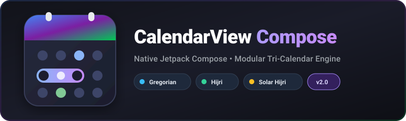

<p align="center">
  
</p>

<p align="center">
  <a href="https://jitpack.io/#mortezasun/android-calendarview"></a>
  <a href="https://github.com/mortezasun/android-calendarview/actions/workflows/android-verification.yml"></a>
  <a href="https://github.com/mortezasun/android-calendarview/actions/workflows/android-instrumentation.yml"></a>
  
  
  
</p>

A native Jetpack Compose calendar library for Android. It ships one shared, calendar-independent core (month grid, selection engine, containers, heatmaps) plus pluggable calendar engines for **Gregorian**, **Islamic Hijri** and **Solar Hijri (Jalali / Persian)** — with full RTL support.

---

## Contents

- [Features](#-features)
- [Modules](#-modules)
- [Installation](#-installation)
- [Quick start](#-quick-start)
- [Selection modes](#-selection-modes)
- [Customization](#-customization)
- [Scrolling containers](#-scrolling-containers)
- [Heatmaps](#-heatmaps)
- [Custom calendars (low-level grid)](#-custom-calendars-low-level-grid)
- [Migrating from 1.x](#-migrating-from-1x)
- [Building from source](#-building-from-source)
- [Documentation](#-documentation)
- [License](#-license)

---

## ✨ Features

- **100% Jetpack Compose** – no XML layouts, ViewBinding or reflection.
- **Multiple calendar systems** – Gregorian (`java.time`), Hijri (`java.time.chrono.HijrahDate`) and Solar Hijri (`ir.huri.jcal.JalaliCalendar`).
- **One selection engine for all calendars** – `None`, `Single`, `Multiple` and `Range`, keyed by absolute epoch days and saved across process death via `rememberSaveable`.
- **Configurable month grid** – dynamic rows or fixed 6 rows (42 cells), independently toggleable previous/next-month days, header/weekday visibility, disabled dates and a customizable *today* border.
- **Scrolling containers** – `CalendarMonthList` (`LazyColumn`/`LazyRow`) and `CalendarMonthPager` (`HorizontalPager`/`VerticalPager`).
- **Heatmaps** – Gregorian quarter/year heatmaps plus a calendar-agnostic year heatmap that works with any engine.
- **Accessibility & RTL** – localized content descriptions, 48 dp touch targets, and layout that follows the ambient `LayoutDirection`.
- **Controlled & stateless** – the caller owns selection and navigation; the library only renders and reports clicks.

---

## 🧱 Modules

| Module | Package | Purpose |
|--------|---------|---------|
| `:library` | `com.develotter.calendarview` | Core: `CalendarMonthGrid`, selection engine, containers, heatmaps. No calendar-engine dependencies. |
| `:calendar-gregorian` | `…calendars.gregorian` | `GregorianCalendarMonth`, backed by `java.time`. |
| `:calendar-hijri` | `…calendars.hijri` | `HijriCalendarMonth`, backed by `HijrahDate`. |
| `:calendar-solarHijri` | `…calendars.solarHijri` | `SolarHijriCalendarMonth`, backed by `ir.huri:jalalicalendar` (exposed as `api`). |
| `:calendarviewsample` | `com.develotter.calendarviewsample` | Interactive demo app (month views, containers, dialog, heatmaps). |

Every calendar module depends on `:library` via `api`, so adding an engine is enough to get the core.

---

## 📦 Installation

Add JitPack to `settings.gradle.kts`:

```kotlin
dependencyResolutionManagement {
    repositoriesMode.set(RepositoriesMode.FAIL_ON_PROJECT_REPOS)
    repositories {
        google()
        mavenCentral()
        maven { url = uri("https://jitpack.io") }
    }
}
```

Add the engines you need to your module's `build.gradle.kts`:

```kotlin
dependencies {
    // Core only (needed if you build your own calendar on top of CalendarMonthGrid)
    implementation("com.github.mortezasun.android-calendarview:library:2.0.0")

    // Calendar engines (each one already includes :library)
    implementation("com.github.mortezasun.android-calendarview:calendar-gregorian:2.0.0")
    implementation("com.github.mortezasun.android-calendarview:calendar-hijri:2.0.0")
    implementation("com.github.mortezasun.android-calendarview:calendar-solarHijri:2.0.0")
}
```

> [!NOTE]
> `2.0.0` is developed on the `update` branch and has not been tagged yet (latest tag: `1.1.0-alpha2`, View-based API).
> Until the release tag exists, you can depend on the branch snapshot with `update-SNAPSHOT` instead of `2.0.0`.

---

## 🚀 Quick start

### Gregorian

```kotlin
@Composable
fun GregorianScreen() {
    val state = rememberCalendarSelectionState(TypeSelectDay.Range)

    GregorianCalendarMonth(
        month = YearMonth.now(),
        selection = state.selection,
        onDateClick = { date -> state.onDayClick(date.toEpochDay()) },
        showPreviousMonthDays = true,
        showNextMonthDays = true,
        fixedSixRows = true,
    )
}
```

### Hijri (Islamic)

```kotlin
@Composable
fun HijriScreen() {
    val state = rememberCalendarSelectionState(TypeSelectDay.Single)

    HijriCalendarMonth(
        month = HijrahDate.now(),
        selection = state.selection,
        onDateClick = { date -> state.onDayClick(date.toEpochDay()) },
    )
}
```

### Solar Hijri / Jalali (Persian)

```kotlin
@Composable
fun SolarHijriScreen() {
    val state = rememberCalendarSelectionState(TypeSelectDay.Multiple)

    SolarHijriCalendarMonth(
        month = JalaliCalendar(),
        selection = state.selection,
        onDateClick = { date -> state.onDayClick(solarHijriEpochDay(date)) },
        locale = Locale.forLanguageTag("fa-IR"),
    )
}
```

> [!TIP]
> All engines share the same epoch-day timeline, so a single `CalendarSelectionState` can be shown in Gregorian, Hijri and Jalali views at the same time.

---

## 🎯 Selection modes

| `TypeSelectDay` | Behavior |
|-----------------|----------|
| `None` | Clicks are reported, nothing is selected. |
| `Single` | One selected day; a new tap replaces it. |
| `Multiple` | Toggle any number of days. |
| `Range` | First tap = start, second tap = end; a third tap starts a new range. |

```kotlin
val state = rememberCalendarSelectionState(
    mode = TypeSelectDay.Multiple,
    initialEpochDays = listOf(LocalDate.now().toEpochDay()),
)

state.selection.selectedDays      // List<Long> (epoch days, sorted)
state.selection.isRangeComplete   // Range mode only
LocalDate.now().toEpochDay() in state.selection
state.clear()
```

`CalendarSelection` is a plain, UI-independent class – you can also hold it in a `ViewModel` and call `selection.onDayClick(epochDay)` yourself.

---

## 🎨 Customization

All engine composables (`GregorianCalendarMonth`, `HijriCalendarMonth`, `SolarHijriCalendarMonth`) share these optional parameters:

| Parameter | Default | Description |
|-----------|---------|-------------|
| `locale` | `Locale.getDefault()` | Month names, weekday labels and digits. |
| `firstDayOfWeek` | locale-based (Gregorian) / `SATURDAY` (Hijri, Jalali) | First column of the grid. |
| `showPreviousMonthDays` / `showNextMonthDays` | `false` | Show adjacent-month days in the leading/trailing cells. |
| `fixedSixRows` | `false` | Always render 42 cells to avoid height jumps between months. |
| `showHeader` / `showWeekdayLabels` | `true` | Toggle the month title and weekday row. |
| `today` | now | Date highlighted as *today*. |
| `todayBorderColor` | `MaterialTheme.colorScheme.tertiary` | Border color of the *today* indicator. |
| `isDateEnabled` | `{ true }` | Disable dates (e.g. past days or weekends). |

```kotlin
GregorianCalendarMonth(
    month = YearMonth.now(),
    selection = state.selection,
    onDateClick = { state.onDayClick(it.toEpochDay()) },
    firstDayOfWeek = DayOfWeek.MONDAY,
    todayBorderColor = Color(0xFF00897B),
    isDateEnabled = { it >= LocalDate.now() },
)
```

---

## 📜 Scrolling containers

`CalendarMonthList` and `CalendarMonthPager` are calendar-independent: you supply a month count and render any month composable per index.

```kotlin
val months = remember { (-12..12).map { YearMonth.now().plusMonths(it.toLong()) } }
val pagerState = rememberPagerState(initialPage = 12, pageCount = { months.size })

CalendarMonthPager(
    monthCount = months.size,
    state = pagerState,                    // pageCount must equal monthCount
    axis = CalendarScrollAxis.Horizontal,  // or Vertical
    monthKey = { months[it].toString() },
    onMonthActive = { index -> /* settled page */ },
    modifier = Modifier.height(420.dp),    // pagers need a bounded viewport
) { index ->
    GregorianCalendarMonth(
        month = months[index],
        selection = state.selection,
        onDateClick = { state.onDayClick(it.toEpochDay()) },
        fixedSixRows = true,
    )
}
```

`CalendarMonthList` has the same shape and uses a `LazyListState`; for `CalendarScrollAxis.Horizontal` each month gets `horizontalMonthWidth` (default `320.dp`).

---

## 🔥 Heatmaps

### Gregorian year / quarter

```kotlin
CalendarYearHeatmap(
    year = 2026,
    intensities = mapOf(LocalDate.of(2026, 1, 5) to 0.8f), // values are clamped to 0..1
    onDayClick = { date -> println("Clicked $date") },
)
```

`CalendarQuarterHeatmap(year, quarter, intensities, onDayClick)` renders a single quarter and additionally accepts `colorForIntensity` and `dayContent`.

### Any calendar (Hijri, Jalali, …)

The calendar-agnostic overload takes pre-built `HeatmapMonthData` blocks, so `:library` stays free of engine dependencies. Build them from the engine's month data (`gregorianMonthData`, `hijriMonthData`, `solarHijriMonthData`):

```kotlin
fun SolarHijriMonthData.toHeatmap(intensity: (Long) -> Float): HeatmapMonthData {
    val cells = buildList<HeatmapDayData?> {
        repeat(firstDayOffset) { add(null) }
        days.forEach { add(HeatmapDayData(it.epochDay, it.accessibilityLabel, intensity(it.epochDay))) }
        while (size % 7 != 0) add(null)
    }
    return HeatmapMonthData(title, weekdayLabels, cells.chunked(7))
}

val months = (1..12).map { m -> solarHijriMonthData(JalaliCalendar(1405, m, 1)).toHeatmap { 0.5f } }

CalendarYearHeatmap(
    months = months,
    onDayClick = { day -> println(day.label) },
)
```

See [`CalendarSampleHeatmap.kt`](calendarviewsample/src/main/java/com/develotter/calendarviewsample/CalendarSampleHeatmap.kt) for a complete example covering all three engines.

---

## 🧩 Custom calendars (low-level grid)

`CalendarMonthGrid` is the stateless building block used by all engines. Provide the title, seven weekday labels, the first-day offset and a list of `CalendarDayCell`s — any calendar system can be rendered this way. Slots (`header`, `weekdayContent`, `dayContent`) let you replace the default UI, and `adjacentDayProvider` supplies cells for previous/next-month days.

---

## 🔁 Migrating from 1.x

Version 2.0.0 removes all View-based components (`MultiMonthView`, `MonthView`, `DayHeatMapView`, XML layouts, ViewBinding) in favor of Compose. See [docs/V2_MIGRATION_MAPPING.md](docs/V2_MIGRATION_MAPPING.md) for the full 1.x → 2.0.0 mapping.

---

## 🔨 Building from source

Requirements: JDK 17, Android SDK Platform 37, Build-Tools 36.0.0.
Toolchain: Kotlin 2.4.21, AGP 9.5.1, Gradle 9.8.2, Compose BOM 2026.09.00, `compileSdk`/`targetSdk` 37, `minSdk` 27.

```bash
git clone -b update https://github.com/mortezasun/android-calendarview.git
cd android-calendarview
./gradlew :calendarviewsample:assembleDebug   # build the demo app
./gradlew test                                # JVM unit tests (all modules)
./gradlew lintDebug                           # Android Lint
./gradlew connectedDebugAndroidTest           # instrumentation tests (device/emulator)
```

CI runs the same checks on GitHub Actions – see [docs/CI.md](docs/CI.md).

---

## 📚 Documentation

| Document | Content |
|----------|---------|
| [ARCHITECTURE.md](docs/ARCHITECTURE.md) | Compose architecture, rendering and state model |
| [V2_MIGRATION_MAPPING.md](docs/V2_MIGRATION_MAPPING.md) | 1.x → 2.0.0 migration matrix |
| [PROJECT_STATUS.md](docs/PROJECT_STATUS.md) | Verified status, test coverage, release notes |
| [ADJACENT_MONTH_DAYS.md](docs/ADJACENT_MONTH_DAYS.md) | Previous/next-month day behavior |
| [COMPOSE_MONTH_CONTAINERS.md](docs/COMPOSE_MONTH_CONTAINERS.md) | List and pager containers |
| [SETUP.md](docs/SETUP.md) · [DEVELOPMENT.md](docs/DEVELOPMENT.md) | Local setup and development workflow |
| [CI.md](docs/CI.md) · [COMPOSE_TESTS.md](docs/COMPOSE_TESTS.md) | CI pipelines and tests |
| [docs/decisions/](docs/decisions) | Architecture decision records |
| [AGENTS.md](AGENTS.md) | Working rules for coding agents |

---

## 📄 License

```
Copyright (c) mortezasun

Licensed under the Apache License, Version 2.0.
```

See [LICENSE](LICENSE) for the full text.
